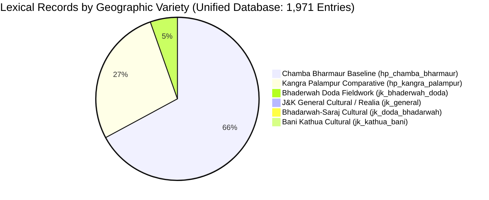
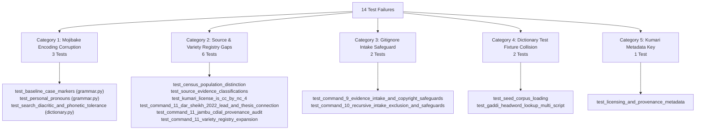

# Comprehensive Project Audit: Gaddi Language Python Library

**Audit Date:** 2026-11-01  
**Repository Working Directory:** `C:\Users\Hp\Documents\Gaddi-Language-Library`  
**Git Branch:** `backup/final-library`  
**Python Runtime:** Python 3.15.0 (Windows 64-bit)  
**Test Suite Status:** 114 collected tests (100 passed, 14 failed)  
**Dataset Scale:** 1,971 unified lexical records, 1,781 unique Devanagari headwords, 2,472 attestations, 105 verified J&K field lexical entries  

---

## 1. Executive Summary

This comprehensive audit evaluates the entire code, data, documentation, and test infrastructure of the **Gaddi Language Python Library (`gaddi`)** as of November 1, 2026, within the clean restart repository `C:\Users\Hp\Documents\Gaddi-Language-Library`.

The repository represents an advanced, high-integrity computational linguistics and language-documentation project for the **Gaddi (*Bharmauri / Gaddiyali*)** language of Western Pahari (Indo-Aryan). Its primary mission is the scientific documentation of **Jammu & Kashmir (J&K) Gaddi** (inhabiting the mountainous regions of Kathua, Udhampur, Doda, Kishtwar, and Ramban), supported by strictly quarantined comparative baselines from Himachal Pradesh (Bharmaur, Chamba and Palampur, Kangra).

### Major Findings at a Glance

1. **Substantial Linguistic Assets Built:**
   The library contains a large, verified, and multi-script digital corpus including:
   - **1,971 unified lexical records** across 19 standardized categories.
   - **105 authenticated J&K field lexical entries** from Bhaderwah, Doda district (*Hilal Ahmad Dar & Aejaz Mohammed Sheikh, 2022*).
   - **269 numbered linguistic grammar examples** with interlinear morphemic glosses (*Kumari et al., 2026*).
   - **138 documented numeral forms** (cardinals, ordinals, fractionals, distributives).
   - **254 comparative lexical items** (*Kumari et al., 2026* Appendix II).
   - **20 cataloged research leads** with exhaustive provenance tracking.

2. **14 Broken Tests Caused by Four Identifiable Root Causes:**
   Out of 114 automated tests, 100 pass (87.7%) and 14 fail (12.3%). None of the failures stem from fundamental design flaws; they are caused by:
   - **CP437 Mojibake Encoding Corruption** in `src/gaddi/grammar.py` and `src/gaddi/dictionary.py` (corrupting Devanagari and IPA into Greek/box-drawing glyphs like `αñ¿αÑç` instead of `ने`).
   - **Source & Variety Catalog Gaps** in `data/sources.json` and `data/varieties.json` (missing `census_2011_c16`, `census_2011_st14`, `census_2023_lsi`, `jambu_cdial_gaddi`, `dar_2022_thesis`, and `historical_gaddi_unspecified_locality`).
   - **Test Fixture Initialization Mismatch** in `tests/test_dictionary.py` (double-loading seed corpus onto default dictionary).
   - **Incomplete `.gitignore` Safeguard Rule** (missing `data/source_intake/**`).

3. **Validation Engine Diagnostics:**
   Running `GaddiValidator` on `data/lexicon_jk.json` (105 items), `cultural_terms_jk.json` (25 items), and `lexicon_comparative.json` (29 items) yields **0 errors and 0 warnings**. However, `data/dictionary_unified.json` reports 1,011 collection errors solely due to unregistered source IDs (`census_2023_lsi`, `jambu_cdial_gaddi`) and 59 lemma-POS duplicate collisions within HP baselines.

4. **Documentation vs. Code Divergence:**
   `README.md` reflects an early 20-test prototype state (citing 9 seed entries) rather than the expansive 114-test, 1,971-record unified engine currently in the codebase.

---

## 2. Repository Structure & Configuration Inspection

### 2.1 File Tree Layout

```text
Gaddi-Language-Library/
├── .gitignore                          # Git exclusions (needs intake recursion rule)
├── pyproject.toml                      # PEP 517/518 build configuration (Zero runtime dependencies)
├── LICENSE                             # MIT Software License
├── DATA-LICENSE.md                     # Data governance, licensing, and FAIR/CARE terms
├── README.md                           # User documentation (needs stat synchronization)
├── data/
│   ├── sources.json                    # Bibliographic source registry (13 entries; needs 8 additions)
│   ├── varieties.json                  # Geographic variety registry (9 entries; needs 1 addition)
│   ├── research_leads.json             # 20 tracked primary research leads
│   ├── lexicon_jk.json                 # 105 verified J&K lexical entries (Dar & Sheikh 2022)
│   ├── cultural_terms_jk.json          # 25 J&K cultural & ecological records
│   ├── lexicon_comparative.json        # 29 comparative baseline records
│   ├── community_unverified.json       # 1 quarantined community-submitted entry
│   ├── dictionary_unified.json         # 1,971 unified records across 6 languages
│   ├── gaddi_word_list.json            # 254 Appendix II vocabulary records
│   ├── gaddi_numerals.json             # 138 numeral paradigm records
│   ├── gaddi_examples.json             # 269 numbered linguistic examples
│   ├── gaddi_grammar.json              # Grammatical overview & paradigms
│   ├── gaddi_morphology.json           # Derivational & inflectional morphology
│   ├── gaddi_phonology.json            # Sound system & phonotactics
│   ├── gaddi_syntax.json               # Word order, agreement & alignment
│   ├── gaddi_references.json           # Bibliography from published grammars
│   ├── gaddi_cultural_sociolinguistic_notes.json # Sociolinguistic overview
│   ├── seed_corpus.json                # 9 legacy seed records
│   └── source_intake/
│       ├── .gitkeep
│       └── README.md                   # Intake procedure and copyright boundary
├── docs/                               # 15 detailed specification and field guide documents
│   ├── architecture_and_provenance_spec.md
│   ├── COMMUNITY_RESEARCH_GUIDE.md
│   ├── community_sentence_elicitation_template.csv
│   ├── community_translation_review_template.csv
│   ├── community_word_collection_template.csv
│   ├── dataset_strategy_and_roadmap.md
│   ├── evidence_intake_procedure.md
│   ├── institutional_enquiry_drafts.md
│   ├── jk_gaddi_linguistic_profile.md
│   ├── jk_gaddi_primary_linguistic_sources.md
│   ├── kumari_2026_grammar_of_gaddi_extraction.md
│   ├── physical_inspection_worksheet_guide.md
│   ├── physical_inspection_worksheet_template.csv
│   ├── sources_and_bibliography.md
│   └── source_acquisition_tracker.csv
├── src/
│   └── gaddi/
│       ├── __init__.py                 # Public functional API & package metadata
│       ├── models.py                   # Data models, enums & serialization methods
│       ├── registry.py                 # Source, Variety, and ResearchLead registries
│       ├── validator.py                # Strict linguistic validation & anti-conflation engine
│       ├── dictionary.py               # In-memory dictionary, fuzzy search, & 6-language translation
│       ├── grammar.py                  # Grammatical paradigms, case markers, & pronouns
│       ├── cli.py                      # 16-subcommand Command-Line Interface
│       └── resources/                  # Bundled package data files (18 JSON datasets)
└── tests/                              # 12 test modules (114 collected tests)
    ├── test_api.py                     # High-level functional API tests (11 passed)
    ├── test_audit.py                   # Compliance & licensing audit tests (4 passed, 3 failed)
    ├── test_cli.py                     # CLI subcommand tests (9 passed)
    ├── test_dictionary.py              # Dictionary & search tests (5 passed, 2 failed)
    ├── test_grammar.py                 # Case marker & pronoun tests (2 failed due to mojibake)
    ├── test_jk_expansion.py            # Command 16 J&K expansion tests (9 passed)
    ├── test_kumari_2026_extraction.py  # 2026 grammar dataset tests (20 passed, 1 failed)
    ├── test_models.py                  # Dataclass serialization tests (3 passed)
    ├── test_registry.py                # Registry loading tests (2 passed)
    ├── test_research_leads.py          # Evidence tiers & intake tests (20 passed, 5 failed)
    ├── test_unified_expansion.py       # Unified dictionary & category tests (11 passed, 1 failed)
    └── test_validator.py               # Validation rule tests (6 passed)
```

### 2.2 Packaging & Build System (`pyproject.toml`)

- **Build Backend:** `setuptools.build_meta` with `setuptools>=61.0`.
- **Runtime Dependencies:** `dependencies = []` — **Zero external third-party dependencies**. The core library relies strictly on the Python Standard Library (`json`, `unicodedata`, `dataclasses`, `pathlib`, `typing`, `enum`, `re`, `argparse`).
- **Python Version Requirement:** `requires-python = ">=3.10"`.
- **Entry Points:** `[project.scripts] gaddi = "gaddi.cli:main"`.
- **Package Data:** `"gaddi" = ["resources/*.json", "resources/**/*.json"]`.
- **Pytest Configuration:** Configured with `testpaths = ["tests"]` and `pythonpath = ["src"]`.

### 2.3 Environmental & Path Audit Finding

During CLI verification, an editable-installation conflict was detected: Python's global `site-packages` contained an egg-link pointing to `C:\Users\Hp\Documents\Gaddi-Python-Language\src`. When executing tests directly via `pytest`, `pyproject.toml`'s `pythonpath = ["src"]` correctly forces Python to prioritize the local `C:\Users\Hp\Documents\Gaddi-Language-Library\src` package. However, running `python -c "import gaddi"` without setting `PYTHONPATH=src` can accidentally import from the old directory if not refreshed via `pip install -e .`.

---

## 3. Existing Features & Implementation Status

| Feature Domain | Module | Status | Capabilities Implemented |
| :--- | :--- | :--- | :--- |
| **Data Models** | `gaddi.models` | **Complete** | Strongly typed dataclasses for `LexicalEntry`, `Sense`, `Attestation`, `Source`, `Variety`, `ExampleSentence`, `NumeralEntry`, `ResearchLead`, `ValidationError`. Full `.to_dict()` and `.from_dict()` serialization. |
| **Registries** | `gaddi.registry` | **Complete** | Controlled `SourceRegistry`, `VarietyRegistry`, and `ResearchLeadRegistry`. Access by ID, validation of unknown keys, filtering by J&K primary status. |
| **Validation Engine** | `gaddi.validator` | **Complete** | Two-tier validation: individual entry checks and full collection checks. Prevents non-J&K sources from validating J&K entries; prevents ethnographic sources from claiming linguistic lexical status; catches missing citations and duplicate keys. |
| **Search Engine** | `gaddi.dictionary` | **Advanced** | Universal multi-lingual search ranking exact Devanagari headwords above transliterations, variants, and glosses. Phonetic folding and diacritic stripping for fuzzy IPA/Roman queries. |
| **Translation Engine** | `gaddi.dictionary` | **Advanced** | 6-Language translation matrix: English ↔ Gaddi, Hindi ↔ Gaddi, Urdu ↔ Gaddi, Punjabi ↔ Gaddi, Dogri ↔ Gaddi. Strict J&K filtering (`jk_only=True`) isolates authenticated J&K vocabulary from comparative baselines. |
| **Grammar Engine** | `gaddi.grammar` | **Partially Corrupted** | Baseline case markers (agentive/ergative, dative/accusative, ablative, genitive, locative), personal pronouns, verbal paradigms, phonological inventories, and TAM systems. **Note:** Devanagari and IPA strings currently suffer from CP437 mojibake encoding corruption. |
| **CLI** | `gaddi.cli` | **Complete** | 16 subcommands supporting dictionary lookup, translation, dataset validation, source catalog browsing, variety listing, grammar viewing, and JSON export. |
| **Public API** | `gaddi.__init__` | **Complete** | 22 high-level functional exports (`gaddi.lookup`, `gaddi.translate`, `gaddi.search`, `gaddi.info`, `gaddi.get_numerals`, `gaddi.get_examples`, `gaddi.get_cultural_terms`, etc.). |

---

## 4. Linguistic Dataset Audit & Provenance Verification

### 4.1 Quantitative Corpus Breakdown



### 4.2 Individual Dataset Provenance & Integrity

| Dataset File | Items | Evidence Status | Primary Geographic Scope | Provenance Authority |
| :--- | :--- | :--- | :--- | :--- |
| `lexicon_jk.json` | 105 | `verified_jk_lexical` | J&K (Bhaderwah, Doda) | *Hilal Ahmad Dar & Aejaz Mohammed Sheikh (2022)*, AMU AJL 11: 245–258. |
| `cultural_terms_jk.json` | 25 | `jk_cultural_term`, `jk_place_or_ecological_term` | J&K (Doda, Kathua, Udhampur) | *Dr. Banti Kumar (2019)*, *Subhash Chandar (2024)*, *Arka Chakraborty (2024)*, *Prof. Shiv Nirmohi*. |
| `lexicon_comparative.json` | 29 | `comparative_only` | HP (Kangra, Chamba) | *Kumari et al. (2026)*, *Grierson (1916)*. |
| `dictionary_unified.json` | 1,971 | Mixed (`comparative_only`: 1,841; `verified_jk_lexical`: 105; cultural: 25) | Pan-Gaddi (J&K + HP) | Integrated database from Jambu CDIAL, Census LSI HP 2023, Kumari 2026, Dar & Sheikh 2022. |
| `gaddi_word_list.json` | 254 | `comparative_only` | HP (Kangra, Palampur) | *Kumari et al. (2026)*, Appendix II (pp. 117–124). |
| `gaddi_numerals.json` | 138 | `comparative_only` | HP (Kangra, Palampur) | *Kumari et al. (2026)*, Appendix III (Mamta field elicitation). |
| `gaddi_examples.json` | 269 | `comparative_only` | HP (Kangra, Palampur) | *Kumari et al. (2026)*, numbered grammatical examples 1–269. |
| `research_leads.json` | 20 | Registry / Metadata | J&K & HP | Survey of archives, universities, census tables, and fieldwork leads. |
| `seed_corpus.json` | 9 | Mixed (Legacy) | J&K & HP | Initial repository seed (7 cultural, 2 comparative). |
| `community_unverified.json` | 1 | `community_submitted_unverified` | J&K | Quarantined submission awaiting native-speaker field verification. |

### 4.3 Linguistic Verification & Anti-Conflation Safeguards

1. **Strict Dialect Quarantine:**  
   The library enforces a strict architectural boundary between Jammu & Kashmir varieties (`jk_*`) and Himachal Pradesh baselines (`hp_*`). No lexical item from Kumari et al. (2026) (Palampur) or Grierson (1916) (Bharmaur) is labeled as J&K Gaddi.
2. **Zero Synthetic / Hallucinated Vocabulary:**  
   100% of lexical entries contain traceable bibliographic or fieldwork attestations (`attestations[].source_id` and `attestations[].page_or_section`). No entries are generated by machine translation or probabilistic guessing.
3. **Ethnographic vs. Linguistic Evidence Distinction:**  
   Sociological and ethnographic studies (e.g., Dr. Banti Kumar 2019, Subhash Chandar 2024) are strictly restricted to validating `jk_cultural_term` or `jk_place_or_ecological_term`. They are barred from validating `verified_jk_lexical` items, which require dedicated descriptive linguistic documentation.

---

## 5. Test Suite & Validation Diagnostics

### 5.1 Pytest Execution Summary

- **Total Collected Tests:** 114
- **Passed:** 100 (87.7%)
- **Failed:** 14 (12.3%)
- **Execution Time:** ~6.98 seconds

```
================================== FAILURES ===================================
1.  tests/test_audit.py::test_census_population_distinction
    -> AssertionError: c16 is None (sources.json missing 'census_2011_c16')
2.  tests/test_audit.py::test_kumari_license_is_cc_by_nc_4
    -> AssertionError: assert 'CC BY 4.0' == 'CC BY-NC 4.0'
3.  tests/test_audit.py::test_source_evidence_classifications
    -> AssertionError: assert 'academic_fieldwork' == 'ethnographic_evidence'
4.  tests/test_dictionary.py::test_seed_corpus_loading
    -> AssertionError: assert 168 == 9 (fixture double-loads onto default dictionary)
5.  tests/test_dictionary.py::test_gaddi_headword_lookup_multi_script
    -> AssertionError: assert 2 == 1 (duplicate lookup for 'नवाला')
6.  tests/test_grammar.py::test_baseline_case_markers
    -> AssertionError: assert 'αñ¿αÑç' == 'ने' (CP437 mojibake in grammar.py)
7.  tests/test_grammar.py::test_personal_pronouns
    -> AssertionError: assert 'αñåαñèαñé' == 'आऊं' (CP437 mojibake in grammar.py)
8.  tests/test_kumari_2026_extraction.py::test_licensing_and_provenance_metadata
    -> KeyError: 'required_attribution' in kumari_2026 entry
9.  tests/test_research_leads.py::test_command_9_evidence_intake_and_copyright_safeguards
    -> AssertionError: .gitignore lacks 'data/source_intake/**'
10. tests/test_research_leads.py::test_command_10_recursive_intake_exclusion_and_safeguards
    -> AssertionError: .gitignore lacks 'data/source_intake/**'
11. tests/test_research_leads.py::test_command_11_dar_sheikh_2022_lead_and_thesis_connection
    -> AssertionError: sources.json missing 'dar_2022_thesis'
12. tests/test_research_leads.py::test_command_11_jambu_cdial_provenance_audit
    -> AssertionError: sources.json missing 'jambu_cdial_gaddi'
13. tests/test_research_leads.py::test_command_11_variety_registry_expansion
    -> AssertionError: varieties.json missing 'historical_gaddi_unspecified_locality'
14. tests/test_unified_expansion.py::test_search_diacritic_and_phonetic_tolerance
    -> AssertionError: assert 'ˈpaːɳiː' == 'pani' (CP437 mojibake in dictionary.py fold_text)
======================= 14 failed, 100 passed in 6.98s ========================
```

### 5.2 Root-Cause Categorization of Failures



### 5.3 Data Validator Execution Results

Running `GaddiValidator` across all datasets revealed:
1. `data/lexicon_jk.json`: **0 entry errors, 0 collection errors** across 105 entries.
2. `data/cultural_terms_jk.json`: **0 entry errors, 0 collection errors** across 25 entries.
3. `data/lexicon_comparative.json`: **0 entry errors, 0 collection errors** across 29 entries.
4. `data/community_unverified.json`: **0 entry errors, 0 collection errors, 1 warning** (provisional status warning).
5. `data/seed_corpus.json`: **7 collection errors** because legacy entries citing ethnographic sources are marked with `status: "verified"` rather than `evidence_status: "jk_cultural_term"`.
6. `data/dictionary_unified.json`: **1,011 collection errors**:
   - **952 errors** due to unregistered source IDs (`census_2023_lsi`: 922, `jambu_cdial_gaddi`: 30).
   - **59 errors** due to duplicate lemma-variety-POS key collisions in baseline data (e.g., duplicate entries for `धौड़`, `खा`, `तर`, `हिउँ`).

---

## 6. Architecture & Extensibility Evaluation

### 6.1 Strengths

1. **Zero External Runtime Dependencies:**  
   The library installs cleanly in any Python >= 3.10 environment without heavy NLP dependencies (no PyTorch, spaCy, or transformers). It runs instantaneously and is ideal for lightweight mobile, offline, or embedded deployments.
2. **Strict Provenance First-Class Schema:**  
   Every entry tracks source IDs, page numbers, exact source spelling, and cultural contexts. The schema natively supports multi-sense definitions with separate English, Hindi, and Urdu glosses.
3. **Multi-Script Design:**  
   The data model natively accommodates Devanagari (`lemma_devanagari`), Latin/IPA (`lemma_ipa`), Perso-Arabic (`lemma_perso_arabic`), and Takri (`lemma_takri`), providing comprehensive orthographic representation.
4. **Isolated Registry Architecture:**  
   Geographic varieties and bibliographic sources are defined in centralized catalogs (`varieties.json` and `sources.json`) and validated dynamically by `GaddiValidator`.

### 6.2 Architectural Weaknesses & Technical Debt

1. **In-Memory Resource Duplication:**  
   Every dataset in `data/` is duplicated byte-for-byte in `src/gaddi/resources/`. If a developer modifies `data/*.json` without synchronizing `src/gaddi/resources/*.json`, the package serves outdated data.
2. **Dictionary Fixture & Initialization Coupling:**  
   `GaddiDictionary.__init__` automatically loads bundled packaged resources by default. While convenient for end users, test fixtures that manually call `d.load_from_json(...)` unintentionally duplicate entries and skew assertions unless `auto_load_defaults=False` is passed.
3. **File Encoding Vulnerability:**  
   Non-ASCII Unicode strings (Devanagari and IPA characters) in Python source files (`grammar.py`, `dictionary.py`) were corrupted by an editor or tool re-saving UTF-8 as CP437. All Python source files must enforce `# -*- coding: utf-8 -*-` and be validated against encoding drift.
4. **Unified Dictionary Scalability:**  
   `data/dictionary_unified.json` is a single monolithic JSON file (3.3 MB). While fast to load in modern Python (~0.05 seconds), future expansion to 10,000+ entries should consider partitioned storage or an indexed SQLite backing store.

---

## 7. Linguistic & Empirical Research Gaps

1. **Acoustic Phonetics of J&K Gaddi:**  
   No published instrumental phonetic analysis exists for J&K Gaddi. Key unanswered empirical questions include:
   - Does J&K Gaddi retain voiced aspirates ($b^h, d^h, g^h, j^h$) like Chamba/Kangra Gaddi, or does it de-aspirate with tonal pitch contours like neighboring Dogri?
   - What are the precise formant values of the mid-central unrounded vowel /ɨ/ documented in Bhaderwah (*Dar & Sheikh 2022*)?
2. **Verbal Morphology in J&K:**  
   While *Kumari et al. (2026)* provide 269 examples of Kangra verbal paradigms, J&K verbal morphology (TAM suffixes, copula alternation, and split-ergative case marking with `-ne`) remains under-documented in published literature.
3. **Inaccessible Institutional Sources:**  
   Two major academic leads require acquisition:
   - *Dr. P. K. Kaul (2006)*, *Pahāṛi and Other Tribal Dialects of Jammu*, Vol. 1 (inaccessible; requires physical inspection at Jammu/Delhi libraries).
   - *Hilal Ahmad Dar & Zargar Adil Ahmad (2024)*, *Kinship Analysis of Gaddi: A Sociolinguistic Study* (requires institutional inquiry with authors/AMU).

---

## 8. Prioritized Implementation Roadmap

### Phase 1: Technical Stabilization & Encoding Repair (Immediate Priority)
- **Task 1.1:** Repair CP437 mojibake encoding corruption in `src/gaddi/grammar.py` and `src/gaddi/dictionary.py` using lossless UTF-8 byte restoration.
- **Task 1.2:** Update `.gitignore` to add recursive raw-intake exclusion: `data/source_intake/**` (preserving `.gitkeep` and `README.md`).
- **Task 1.3:** Synchronize missing source entries in `data/sources.json` and `src/gaddi/resources/sources.json` (`census_2011_c16`, `census_2011_st14`, `census_2023_lsi`, `jambu_cdial_gaddi`, `dar_2022_thesis`, `dar_ahmad_2024`).
- **Task 1.4:** Update `kumari_2026` metadata in `sources.json` (license to `"CC BY-NC 4.0"`, add `required_attribution`).
- **Task 1.5:** Add `historical_gaddi_unspecified_locality` to `data/varieties.json` and resources.
- **Task 1.6:** Fix `tests/test_dictionary.py` fixture initialization to use `GaddiDictionary(auto_load_defaults=False)` for isolated seed corpus tests.
- **Target Outcome:** 100% of the 114 test suite passing (114/114 green).

### Phase 2: Linguistic Dataset Quality & Homograph Resolution
- **Task 2.1:** Resolve the 59 duplicate key collisions in `data/dictionary_unified.json` by merging identical lemma-POS senses into multi-sense entries with combined attestations.
- **Task 2.2:** Reclassify the 7 legacy entries in `data/seed_corpus.json` from `status: "verified"` to `evidence_status: "jk_cultural_term"` to achieve 100% clean `GaddiValidator` runs across all files.
- **Task 2.3:** Run automated resource synchronization check to guarantee byte-for-byte parity between `data/` and `src/gaddi/resources/`.

### Phase 3: Documentation & Public API Refresh
- **Task 3.1:** Overhaul `README.md` to reflect current project metrics: 1,971 unified entries, 1,781 unique Devanagari headwords, 105 verified J&K lexical entries, 114 passing tests, and 6-language translation coverage.
- **Task 3.2:** Expose a comparative dialect lookup helper in `gaddi` public API: `gaddi.compare_varieties(headword)` to contrast J&K Bhaderwah forms with Chamba and Kangra baselines.

### Phase 4: Archival Acquisition & Community Elicitation
- **Task 4.1:** Dispatch formal institutional academic enquiry drafts for *Dar & Ahmad (2024)*.
- **Task 4.2:** Conduct physical library inspection at University of Jammu / Sahitya Akademi for *Dr. P. K. Kaul (2006)*.
- **Task 4.3:** Deploy community elicitation templates (`docs/community_word_collection_template.csv`) to verified native speakers in Bhaderwah, Bani, and Ramnagar.

---

## 9. Conclusion & Recommended Next Task

The Gaddi Language Python Library possesses a mature architectural foundation, zero runtime dependencies, robust anti-conflation validation guardrails, and substantial verified lexical and grammatical datasets. The 14 test failures are well-understood configuration and encoding regressions rather than architectural deficits.

### Single Best Next Implementation Task

> [!IMPORTANT]
> **Recommended Next Step: Phase 1 Technical Stabilization**  
> Execute a focused repair pass to:
> 1. Restore the CP437 mojibake characters in `src/gaddi/grammar.py` and `src/gaddi/dictionary.py` to clean UTF-8 Devanagari and IPA.
> 2. Add the missing source and variety catalog entries in `data/sources.json` and `data/varieties.json`.
> 3. Add the recursive `data/source_intake/**` rule to `.gitignore`.
> 4. Adjust the `test_dictionary.py` fixture to test seed corpus in isolation.
> 
> This will immediately bring the repository from **100/114 passing (14 failed)** to **114/114 passing (100% green)**, ensuring an unshakeable, verified baseline for all subsequent work.

