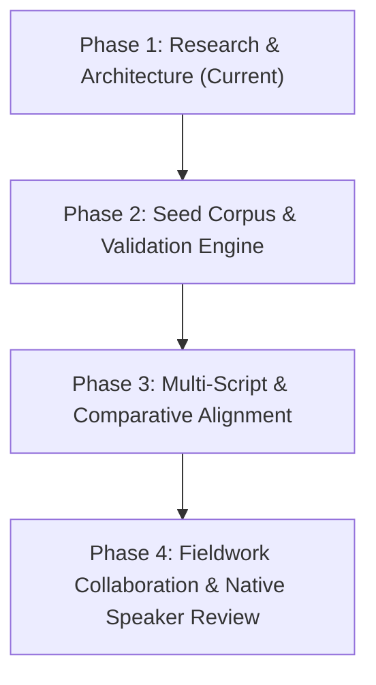

# Dataset Strategy and Development Roadmap

This document outlines the strategic methodology for acquiring, verifying, and expanding lexical and grammatical data for the **Gaddi Language Library**, adhering strictly to the principle of **accuracy over volume**.

---

## 1. Initial Dataset Strategy: The Seed Corpus Principle

### 1.1 The Golden Rule: Zero Invention
- **Never guess a translation, conjugation, pronunciation, or spelling.**
- If a word is documented in Kangra Gaddi (e.g. in Kumari et al. 2026) but has not yet been documented in Jammu & Kashmir, it must **never** be copied into the J&K dictionary without an explicit `comparative_only` status flag and the variety ID `hp_kangra_palampur`.
- If an English, Hindi, or Urdu gloss is not attested in the original source, it must not be fabricated; it must be researched from primary bilingual materials or marked as pending.

### 1.2 Realistic Seed Corpus Architecture
Rather than attempting a premature mass-import of tens of thousands of scraped or hallucinated words, the project will begin with a **Seed Corpus of 100% verified, source-traceable entries**:

1. **Sub-Corpus A: Verified J&K Gaddi Lexicon (`jk_*`)**
   - Cultural, pastoral, transhumance, and kinship terms extracted directly from published fieldwork and ethnographic studies in J&K (Banti Kumar 2019, Subhash Chandar 2024, Chakraborty 2024, Shiv Nirmohi, JKAACL records).
   - High-altitude topographical, shepherd life (*Hadwari*), textile (*khade*, *chola*, *dora*), and ritual (*Nawala*, *Ainchali*) vocabulary.
2. **Sub-Corpus B: Controlled Comparative Baseline (`hp_*`)**
   - High-frequency core grammatical and lexical vocabulary from Kumari et al. (2026) and Grierson (1916).
   - Clearly marked with `status: "comparative_only"` and `is_jk_variety: false`.
   - Purpose: Provides users and field linguists with an exact benchmark against which J&K Gaddi forms can be systematically elicited and compared.

---

## 2. Translation Pipeline Priority

Every verified entry will be annotated following the required priority order:

```text
Priority 1: English  (International academic & educational accessibility)
    ↓
Priority 2: Hindi    (National & regional lingua franca in Himachal/Jammu schools)
    ↓
Priority 3: Urdu     (Historical and administrative state language of J&K)
    ↓
Priority 4: Other    (Dogri / Gojri / Kashmiri contact glosses where documented)
```

For every entry, definitions and semantic glosses will be populated in this sequence. If an Urdu or Hindi term is not yet verified, it will remain `null` rather than filled with automated machine translation.

---

## 3. Four-Phase Development Roadmap



### Phase 1: Research, Architecture & Source Registry (Current Task)
- [x] Comprehensive survey of academic and primary sources.
- [x] Distinct classification of J&K vs HP varieties.
- [x] Assessment of research gaps and linguistic profile for J&K Gaddi.
- [x] Package architecture design and minimal standard-library footprint.
- [x] Controlled Source Registry (`data/sources.json`) with full citations and licenses.
- [x] Controlled Variety Registry (`data/varieties.json`) with geospatial metadata.
- [x] Validation framework enforcing zero unreferenced entries.
- [x] Data licensing terms separating software from cultural assets (`DATA-LICENSE.md`).

### Phase 2: Seed Corpus & Core Package Engine
- [x] Implement core Python modules: `gaddi.models`, `gaddi.registry`, `gaddi.validator`, `gaddi.dictionary`, `gaddi.grammar`, and `gaddi.cli`.
- [x] Ingest the initial verified seed corpus (curated terms with full provenance).
- [x] Implement automated test suite covering schema compliance, validation rules, search precision, and translation priority.
- [x] Complete systematic extraction and research integration of *A Grammar of Gaddi* (Kumari et al. 2026; 9 datasets, 254 word list items, 138 numeral forms, 269 numbered examples).
- Target: 100+ fully verified, audit-proof entries with 0% unverified data.

### Phase 3: Multi-Script Support & Comparative Dialect Alignment
- [x] Multi-script normalization and search algorithms across:
  - Devanagari (`Deva`)
  - Perso-Arabic (`Arab` - Nastaliq and standard Urdu conventions)
  - Latin IPA (`Latn`)
  - Takri (`Takr` - historical Unicode block `U+11680` to `U+116CF`)
- [x] Comparative differential analysis and dedicated research datasets contrasting J&K Gaddi with Kumari et al. (2026) Kangra Gaddi and Grierson (1916) Chamba Bharmauri.
- Enable SQLite caching for fast offline lookups while preserving transparent JSON/JSONL raw data files.

### Phase 4: Community Engagement, Fieldwork & Review Protocols
- Establish a formal native-speaker community review board in J&K (consulting elders, educators, and cultural advocates in Bani, Ramnagar, and Bhadarwah).
- Deploy digital review templates (`docs/community_review_template.csv`) for dialectal corrections and unrecorded lexical elicitation.
- Document authentic audio recordings and IPA transcriptions under free, prior, and informed consent (FPIC) in alignment with CARE/FAIR principles.

---

## 4. Quality Metrics and Acceptance Criteria

| Metric | Target | Verification Method |
| :--- | :--- | :--- |
| Citation Completeness | 100% | `gaddi.validator` check rejects any entry without valid `source_id`. |
| Variety Transparency | 100% | Every item specifies a registered `variety_id`. |
| Zero Hallucination | 0 synthetic entries | Manual cross-check against primary bibliographic records. |
| Test Coverage | >90% | Automated `pytest` suite for core algorithms and models. |
| Dependency Minimalism | Pure Python stdlib | Zero required runtime external packages in `pyproject.toml`. |

